# Decision Modelling: Concept

**Status:** Draft, exploration. No decisions recorded here.
**Tags:** `[V]` verified with a linked source · `[U]` unverified · `[?]` unknown. Nothing tagged `[U]` or `[?]` should be built on before it is closed.

---

## 1. Problem

Business-tech decisions consist of many choices that constrain each other. Today the domain rules exist only as prose in specs. When one choice changes, the choices that depend on it have to be found and revisited by hand, so contradictions get through.

Typical symptoms in a technical specification:

- A decision is treated as settled because it was written inside another one, and nobody revisits it on its own.
- A decision is still marked "decided by X" after a later finding removed X as its justification.
- A choice is feasible only if an open question resolves one way, but nothing records that dependency, so when the question closes the other way nobody notices.

## 2. Concept

Encode the domain once as a **schema**, then let generic software do the rest.

| Stage | Does | Output |
| --- | --- | --- |
| 1. Schema | Declares decisions and their options, constraints (each with source and confidence) and unknowns | Model file |
| 2. Constraint solver | After every choice it **propagates** (which remaining options are still feasible), **detects** conflicts and **explains** them (the minimal set of choices that conflict) | Feasibility per option, explanations |
| 3. Generated UI | Renders the schema: disables options with the reason attached, lists violations and shows the assumptions that feasibility depends on | Interactive configurator |
| 4. Serialisation | Saves the selected configuration plus the explanation trace | JSON |
| 5. LLM write-up | Drafts the decision record or spec section from stage 4 | Draft ADR or spec |

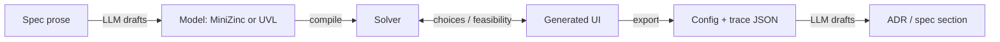

Division of labour: an LLM drafts constraints from prose, the solver enforces them, and the LLM writes up the result. The LLM never asserts feasibility, because the solver output is the ground truth. A human approves both the constraints and the write-up.

The examples below use a small, generic web-application model, described in full in §8.

### 2.1 Authoring a model

The solver checks the model itself before anyone uses it. A *void* model has no valid configuration at all. A *dead* option can never be selected. A *redundant* rule is implied by the others.

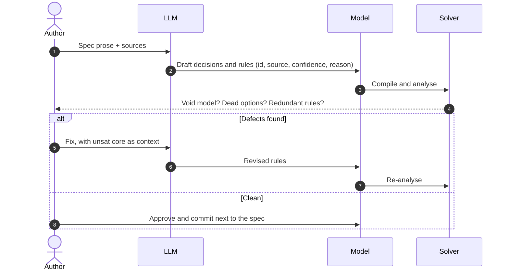

### 2.2 Interactive session

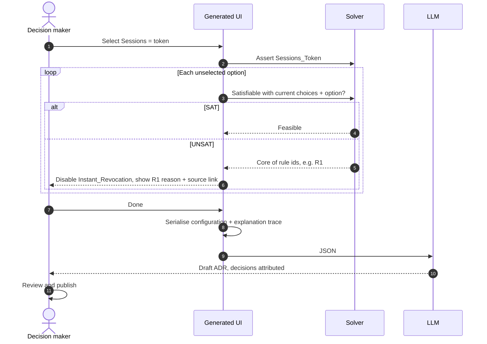

### 2.3 Deciding under open questions

Open questions are assumptions, not blockers. The UI reports what feasibility depends on, and when a question closes, everything is propagated again. A solver does not do this by itself; our layer asks once per value (see §5).

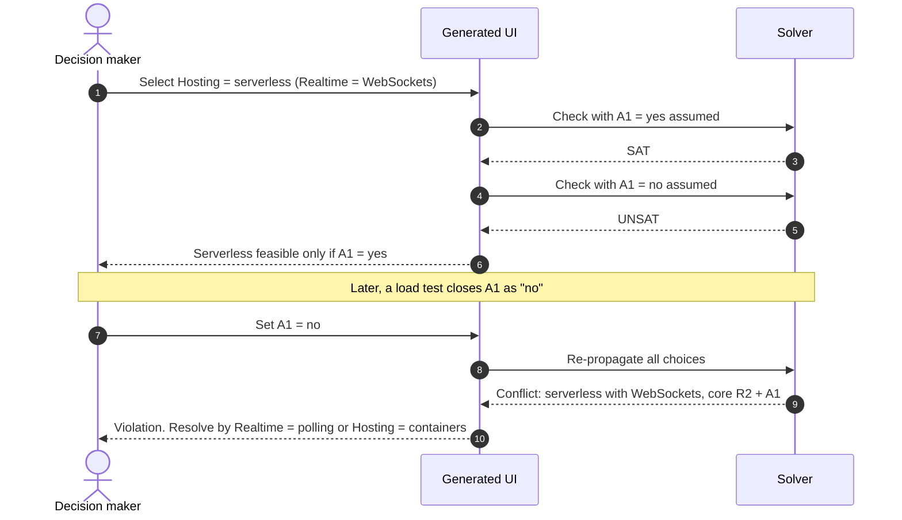

## 3. Prior art

| Field | Provides | Gap for this use |
| --- | --- | --- |
| **Knowledge-based configuration** / product configurators, incl. CPQ (Configure, Price, Quote) tools such as Tacton and Salesforce CPQ `[U]` | Exactly this interactive UX: propagation, disabled options and explanations | Tied to product catalogues and pricing |
| **Feature modelling** (software product lines): [UVL](https://universal-variability-language.github.io), FeatureIDE, flamapy | Schema standard, parsers and automated analysis | Vocabulary is "product features" rather than decisions. Cosmetic, since it feeds on a schema |
| **General morphological analysis** (cross-consistency assessment) | Dimensions × values with a pairwise inconsistency matrix | Pairwise exclusions only, which a schema subsumes. Niche tooling (Carma) `[U]` |
| **Lightweight formal methods**: Alloy, TLA+ | Counterexamples to a spec | No end-user UI. A schema-driven UI generator solves this by integration |
| **Rule / decision engines**: DMN, Drools, OPA/Rego | Evaluate rules on given inputs | Don't search the option space or explain infeasibility |
| **Domain modelling**: Context Mapper, EventStorming | Domain structure | No constraint checking |

The placement below is subjective. The target is the top-right quadrant, which configurators already reach for products. The gap is the schema, not the UX.

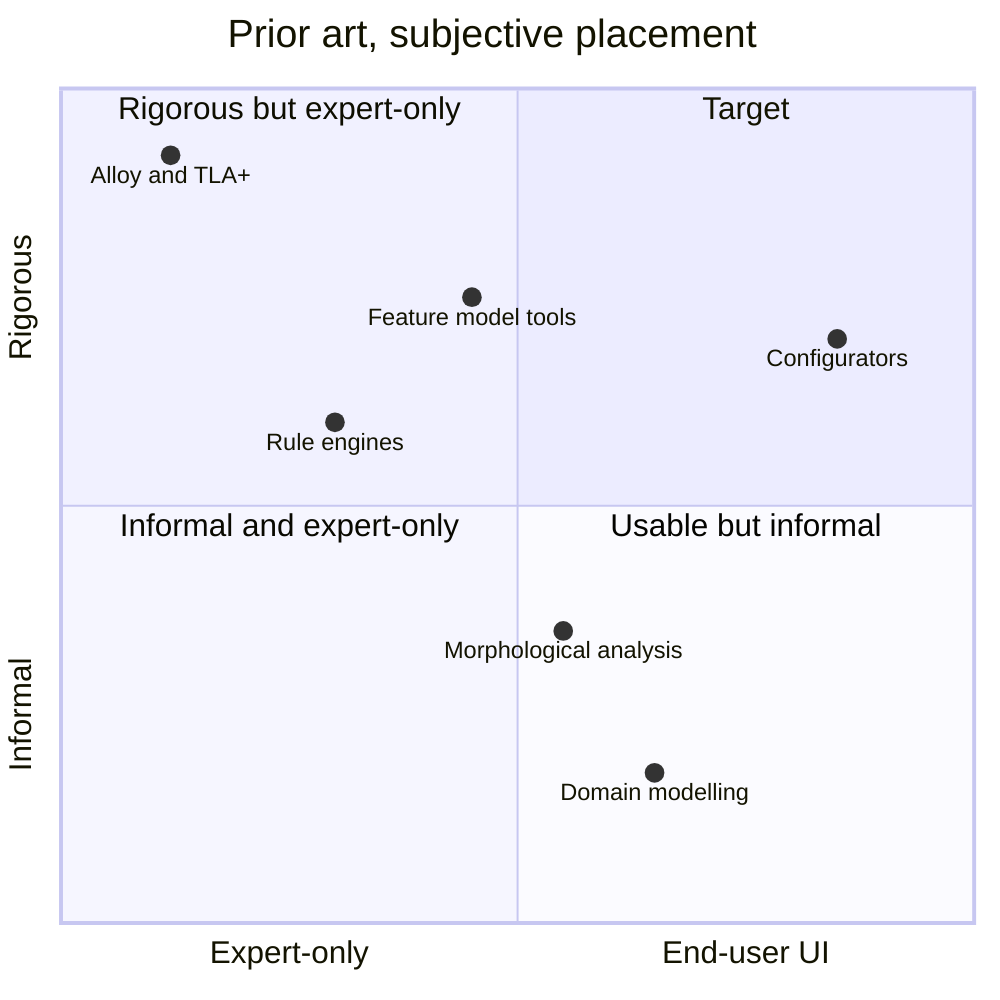

## 4. Schema language

**Requirements:** portable (several parsers and tools), human-readable, able to grow from Boolean logic to arithmetic without a rewrite, and able to carry metadata (id, source, confidence, plain-English reason) on each constraint.

### 4.1 UVL

The Universal Variability Language is a community standard from the MODEVAR initiative. It is organised in levels, and a model opts into a level with `include` `[V]` ([UVL site](https://universal-variability-language.github.io)):

| Level | Adds |
| --- | --- |
| Boolean | Feature tree, mandatory/optional/alternative/or groups, cross-tree constraints, feature attributes, group cardinality |
| Arithmetic | Arithmetic constraints over attributes (`+ - * / = != > <`), `sum()` / `avg()` aggregates, feature cardinality |
| Type | Typed features (String, Integer, Real), numeric functions such as `floor`/`ceil`, string constraints |

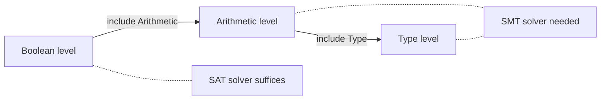

- Major levels are strictly hierarchical, so using Type implies Arithmetic `[V]` ([MODEVAR'25](https://fmt.isti.cnr.it/~mtbeek/MODEVAR25.pdf)). This meets the requirement to start Boolean and add arithmetic later with a single `include`.
- Parsers exist for Java, Python and JavaScript. The JS parser is on npm as `uvl-parser`, runs in the browser and was tested against 1,515 UVLHub models `[V]` ([UVL.js, VaMoS'25](https://victorjlamas.github.io/assets/papers/UVLJsVAMOS2025.pdf)).
- Supported by FeatureIDE, flamapy and pure::variants `[V]` ([UVL.js record](https://ruc.udc.es/entities/publication/12b7968a-a0e3-485f-a82a-809a037b37f3)).
- Caveat: the variability community still has no officially accepted standard, and UVL is the leading candidate `[V]` ([TraVarT paper](https://arxiv.org/html/2403.01952v1)). Adoption is largely academic.

### 4.2 Gap: constraint metadata

UVL can express constraints in three places, and none of them gives a constraint an identity `[V]` ([grammar](https://universal-variability-language.github.io)):

| Where | Example | Is it a node? | Can it carry metadata? |
| --- | --- | --- | --- |
| Implicit in the tree | `alternative` under `Sessions` means exactly one child is selected; a child implies its parent | No, it's group semantics | No |
| `constraints` block (cross-tree constraints) | `Instant_Revocation => Sessions_Server` | No, it's a bare expression | No |
| `constraint` attribute on a feature | `R1 {…, constraint Instant_Revocation => Sessions_Server}` | No, but its host is a node | Yes, through the host's other attributes |

In the grammar, a constraint is only an expression: equation, reference, negation, and/or, implication or equivalence. Attributes exist only on features, and an attribute is either a value attribute or a constraint attribute. So a constraint can't be named or referenced and can't carry anything besides its expression, yet an explanation needs exactly those things.

| Option | How | Trade-off |
| --- | --- | --- |
| **A. Rule-as-feature** | Each rule becomes its own tree node under an abstract `Rules` node. UVL calls every tree node a *feature*, so decisions, options and rules all share that word. In the snippet, `R1` is the rule node, carrying `{id, source, confidence, reason}` plus a `constraint` attribute | Stays valid UVL and keeps metadata in any parser. `[?]` whether tools agree on the semantics of feature-attached constraints |
| B. Sidecar file | Metadata keyed by rule id, with the id written in a `//` comment | Parsers drop comments, so it's fragile |
| C. Custom JSON | Full control | Loses portability. Rejected |

Option A, with R1 from the worked example (§8). The snippet parses with `uvl-parser` 0.5.0 (npm) `[V]`. In UVL, string values take single quotes and quoted feature names take double quotes.

```uvl
namespace WebApp

features
    WebApp {abstract}                  // root node
        mandatory
            Sessions {abstract}        // decision
                alternative            // pick exactly one option
                    Sessions_Server    // option
                    Sessions_Token     // option
            Rules {abstract}           // container node, not a decision
                mandatory              // always selected, so every rule is active
                    R1 {source 'OWASP JWT Cheat Sheet', confidence 255, reason 'A signed token stays valid until it expires, so a logout cannot revoke it instantly', constraint Instant_Revocation => Sessions_Server}    // the rule node
        optional
            Instant_Revocation         // option: may or may not be selected
```

Making `Rules` mandatory is meant to keep every rule active. `[?]` whether that is how tools read it (Q1).

#### Rule-as-feature, step by step

The same rule written both ways. Both versions parse with `uvl-parser` 0.5.0 `[V]`; the diff shows only what changes.

```diff
 features
     WebApp {abstract}
         mandatory
             Sessions {abstract}
                 alternative
                     Sessions_Server
                     Sessions_Token
+            Rules {abstract}
+                mandatory
+                    R1 {source 'OWASP JWT Cheat Sheet', confidence 255, reason 'A signed token stays valid until it expires, so a logout cannot revoke it instantly', constraint Instant_Revocation => Sessions_Server}
         optional
             Instant_Revocation
-
-constraints
-    Instant_Revocation => Sessions_Server
```

The rule node lends the constraint what a bare expression lacks:

| A rule needs | Bare cross-tree constraint | Rule-as-feature |
| --- | --- | --- |
| Identity (rule id) | None | The node name, `R1` |
| Source, confidence, reason | None (comments are dropped by parsers) | Value attributes on the node |
| The logic | The expression | The `constraint` attribute, with the same expression |
| Always in force | Yes, by definition | Yes, because `Rules` and every child under it are `mandatory` `[?]` Q1 |

Conventions this relies on, which our compiler and UI enforce rather than UVL:

- Everything under `Rules` is a rule, not a choice. Because UVL makes each rule a feature, a naive renderer would draw `R1` as a checkbox, and a naive export would list `R1` as selected (it is mandatory, so always true). The renderer and the exporter therefore skip the `Rules` subtree. Rules surface only as explanations.
- Rule names are rule ids, so they are unique and stable (`R1`, `R5`) because explanations cite them.
- Each rule node carries exactly one `constraint` attribute. To express several, write several rules, so each one keeps its own reason.
- `source`, `confidence` (integer 0–255, see §4.4) and `reason` are required.

How the compiler uses it, with the SMT-LIB naming that turns an unsatisfiable core into rule ids (see §5):

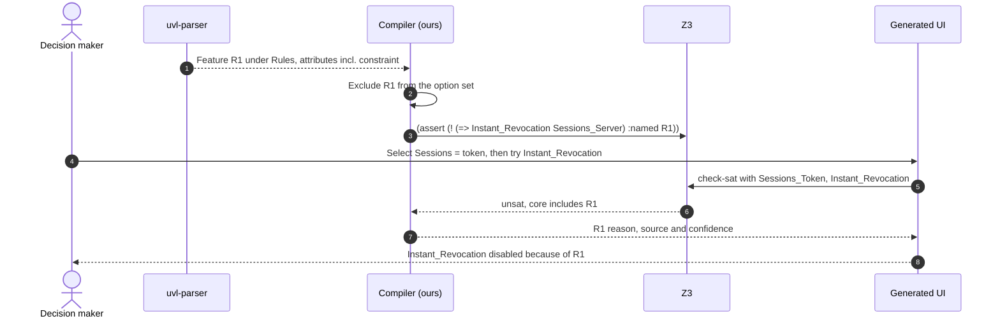

**Upstream fix, not valid UVL today.** Named, attributed constraints in the `constraints` block would make the workaround unnecessary. A sketch for a UVL Enhancement Proposal (UVLEP):

```text
constraints
    R1 {source 'OWASP JWT Cheat Sheet', confidence 255, reason '…'}: Instant_Revocation => Sessions_Server
```

### 4.3 MiniZinc: the other candidate

[MiniZinc](https://docs.minizinc.dev) is a solver-independent constraint modelling language. A model compiles to FlatZinc, which many solvers accept; a stock MiniZinc 2.8.2 install lists Gecode, HiGHS, SCIP, CPLEX, Gurobi and Xpress configurations `[V]` (observed). Enums, integer and float arithmetic, and optimisation (`minimize` / `maximize`) are built in.

It could play one of two roles: a *compile target* behind UVL (the earlier view), or the *authoring language* instead of UVL. The second option is worth taking seriously, because MiniZinc gives constraints an identity natively:

```minizinc
% Rule metadata as a user-defined annotation, type-checked by the compiler
annotation rule(string: source, int: confidence, string: reason);

enum Sessions = { Server, Token };   % decision with its options
var Sessions: sessions;
var bool: instant_revocation;        % option

constraint :: "R1"
  (instant_revocation -> sessions = Server)
  :: rule("OWASP JWT Cheat Sheet", 255, "A signed token stays valid until it expires, so a logout cannot revoke it instantly");

% current choices, supplied by the UI
constraint :: "choice:sessions" sessions = Token;
constraint :: "choice:revocation" instant_revocation;

solve satisfy;
```

Tested with MiniZinc 2.8.2 and Gecode on a model with the same structure: these choices give `UNSATISFIABLE`, and with `not instant_revocation` the model solves `[V]`. A constraint item takes only a string name, so the metadata annotation goes on the expression. Unlike UVL attributes, the `rule(...)` declaration gives the metadata a schema that the compiler enforces.

- **Explanations:** FindMUS lists minimal unsatisfiable subsets of a model, can restrict the search to constraints with string annotations (`--named-only`), offers QuickXplain-based shrinking and has JSON output `[V]` ([FindMUS docs](https://docs.minizinc.dev/en/2.9.4/find_mus.html)). `[?]` FindMUS is not in the Ubuntu package, and it is unknown whether the WebAssembly build includes it.
- **Browser:** `minizinc` on npm runs MiniZinc in the browser on WebAssembly, powers the MiniZinc Playground and loads from jsDelivr `[V]` ([minizinc-js](https://github.com/minizinc/minizinc-js)).

| | UVL with rule-as-feature | MiniZinc |
| --- | --- | --- |
| Rule identity and metadata | Workaround; untyped attributes | Native names; typed annotations |
| Arithmetic | Arithmetic level, no objectives | First-class, including optimisation |
| Explanations | flamapy conflict detection and diagnosis, also via `flamapy-mcp` | FindMUS |
| Structure for the UI | Tree and groups for free | Flat; enums give decisions and options, hierarchy needs a convention (e.g. a `group(...)` annotation) |
| Model analyses | Dead and false-optional features etc. via flamapy | Not built in |
| Ecosystem | Variability modelling, largely academic | Constraint programming, with many solvers behind one language |
| In the browser | `uvl-parser` plus a separate solver | `minizinc` package including solvers |

**Proposal:** spike both on the worked example (§8) and decide (Q6). The lean is towards MiniZinc, because the main reason for the rule-as-feature workaround disappears and only UI hierarchy needs a convention.

**Solver under UVL:** compile to SMT and solve with [Z3](https://github.com/Z3Prover/z3), Microsoft's open-source (MIT) SMT solver `[V]` ([Wikipedia](https://en.wikipedia.org/wiki/Z3_Theorem_Prover)). Z3 is the engine behind stage 2 of the pipeline (§2): it takes the compiled model plus the current choices and answers *sat* (feasible) or *unsat* (infeasible, with a core of rule ids as the explanation). It covers both Boolean and arithmetic constraints, so the UVL Arithmetic level needs no change of solver, and its native input format is SMT-LIB 2. The UVL language-level work already maps the Arithmetic level to SMT `[V]` ([Vill et al., FOSD'23](https://fosd23.uni-ulm.de/assets/pdf/stefan_vill.pdf)). Under MiniZinc, the solver is a configuration choice instead.

SMT-LIB itself is the solver interchange format and is not meant for human authoring.

### 4.4 Confidence

Confidence replaces the `V` / `U` / `?` tags. Encoding and display are separate choices:

- **Stored** as a byte, 0–255, where 255 is 100%. Both UVL attributes and MiniZinc annotations take integers.
- **Shown** as a percentage or band.
- **Absent** (`null`) means *unrated*: nobody has judged the rule yet. In JSON it is `null`; in UVL the attribute is omitted; in MiniZinc an overloaded `rule(source, reason)` annotation without the confidence argument is used, because annotation arguments cannot be optional (`opt int` is rejected) `[V]` (tested, MiniZinc 2.8.2). An unrated rule is treated as soft at the lowest weight and listed for rating.

- **Confidence is separate from evidence.** Confidence says how sure we are; the evidence layer (§4.5) says why.
- **Two kinds of `null`.** A rule with `null` confidence is unrated. A fact whose *value* is unknown (a `[?]`, e.g. A1) is different: it is an assumption variable that is `true`, `false` or `null`. While it is `null`, our layer checks each value explicitly (§5). Merging the two would let an unanswered question look like a weak rule.
- **Solver semantics:** at or above a threshold, a rule is hard. Below it, the rule is soft, and the solver can answer "which low-confidence rules would have to be wrong for this option to be feasible?", weighted by confidence. Both solver routes support this: MiniZinc by maximising the weight of satisfied soft rules, Z3 through weighted soft constraints `[U]`.
- **Risk: false precision.** Whatever the encoding, people can't judge 255 or even 101 levels. Start with a few bands (e.g. 255 verified, 180 likely, 100 plausible, 25 guess) and show bands in the UI. A `[V]` claim maps to 255; a `[U]` claim needs a judgement per rule.

### 4.5 Evidence layer

A confidence value is only as good as what supports it, so every rating keeps a trail: which material, what it says, who judged it, when, and why it produced that value. This trail doesn't belong in the model language. It is the serialised output of its own layer, joined to the model by rule id, which both UVL rule nodes and MiniZinc constraint names provide.

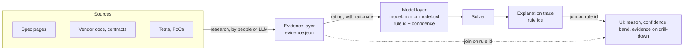

Each layer has its own format and can be produced by a different tool:

| Layer | Holds | Format |
| --- | --- | --- |
| Evidence | Supporting material per rule, and the rating rationale | JSON (any producer) |
| Model | Decisions, options, rules with id and confidence | MiniZinc or UVL |
| Configuration | The current choices and open-question values | JSON |
| Explanation trace | Rule ids from cores, per option | JSON |
| Decision record | The write-up | Markdown, or any documentation system |

Example record for R2 (illustrative shape, not a fixed schema):

```json
{
  "rule": "R2",
  "confidence": 180,
  "rated_by": "reviewer-1",
  "rated_at": "2026-01-15",
  "rationale": "The platform docs describe a connection time limit. Whether it is long enough for our WebSocket sessions is a separate open question (A1) and does not lower this rule",
  "evidence": [
    {
      "kind": "vendor_doc",
      "url": "https://example.com/platform/limits",
      "claim": "Function invocations are terminated after a maximum duration",
      "checked_at": "2026-01-10"
    },
    {
      "kind": "test",
      "ref": "load-test-websockets",
      "claim": "WebSocket connections survive a full user session on the platform",
      "status": "open"
    }
  ]
}
```

Rules this layer makes checkable:

- A rule with confidence but no evidence record is a lint error, and so is evidence whose `checked_at` is older than a chosen age.
- When evidence changes (a document is updated, a test closes an open question), the rules that cite it are flagged for re-rating, which re-runs propagation.
- In the UI, the evidence appears only behind the explicit context change (the rule or assumption view in §6). The at-a-glance layer shows the confidence band.

W3C PROV is a standard vocabulary for this kind of provenance and could replace the ad-hoc fields if the layer needs to interoperate `[U]`.

## 5. Solving and explanation

Each rule becomes a *named* constraint, so the solver's unsatisfiable core comes back as a set of rule ids. Under MiniZinc the names are native (§4.3). Under UVL the compiler adds them, as below. Those ids map directly to the reason and source shown to the user.

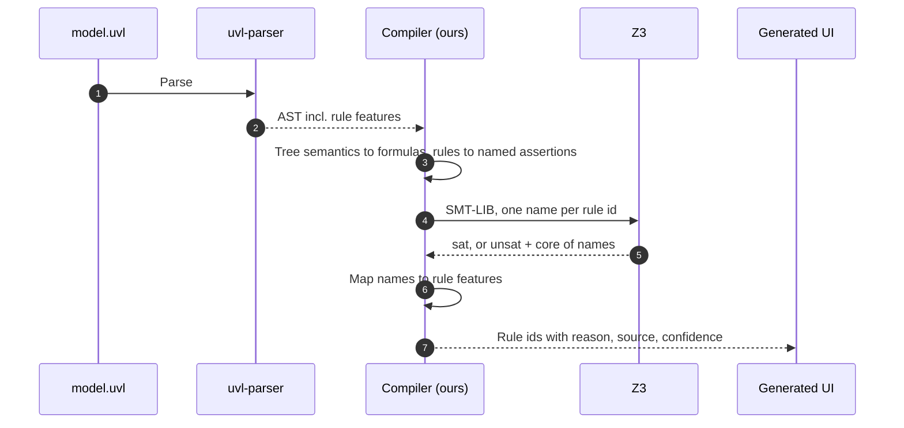

- **Propagation:** for each unselected option, check whether current choices plus that option are satisfiable. Decision models are small, so one solver call per option is fine `[U]`.
- **Explanation:** an unsatisfiable core, or a minimal correction set (the smallest change that restores feasibility). QuickXplain is the classic algorithm from configuration research, and FindMUS uses variants of it `[V]` ([FindMUS docs](https://docs.minizinc.dev/en/2.9.4/find_mus.html)). QuickXplain needs nothing but repeated satisfiability checks over subsets of named rules, so it can run as our own loop on top of the browser solver. That removes any need for a call just to get an explanation; FindMUS or flamapy become conveniences, not dependencies.
- **Unknowns:** a solver does *not* explore both values of an open question. Left unconstrained, a variable is just something it may set to whatever makes the model satisfiable, and one solve returns one witness. Tested with MiniZinc 2.8.2 and Gecode on a model of this shape: with the assumption free, the solver returns it as `true` and says nothing about `false`; only an explicit second run with it set to `false` returns `UNSATISFIABLE` `[V]`. So the layer above the solver asks per value, as assumptions (e.g. Z3's `check-sat-assuming`, or a constraint added per run in MiniZinc) `[U]`:

  | SAT with V = true | SAT with V = false | UI shows |
  | --- | --- | --- |
  | Yes | Yes | Feasible regardless of V |
  | Yes | No | Feasible only if V = true |
  | No | Yes | Feasible only if V = false |
  | No | No | Infeasible regardless; explain with a core |

  That is two checks per option per relevant assumption. Combinations of several open questions grow as 2^k, so only assumptions that appear in a core for that option are toggled.
- **Where solving runs:** three options, not exclusive.
  - **All in the browser:** solver in WebAssembly plus our own QuickXplain loop. No calls.
  - **Through MCP:** a page published as a claude.ai artifact cannot fetch other hosts directly, but its `mcp` runtime capability calls the viewer's claude.ai connectors with the viewer's credentials, including a local MCP server on the viewer's device in the Claude app (`host:<name>`) `[V]` (Artifact runtime contract 0.2.96). So `flamapy-mcp`, run locally with `uvx`, could serve explanations under UVL `[U]` (untested), and a hosted MCP server could wrap FindMUS.
  - **Own server:** if the app is self-hosted. One more service to maintain.
- **Browser solver:** under MiniZinc, the `minizinc` package runs in the browser on WebAssembly `[V]` (§4.3). Under UVL, Z3 has a WebAssembly build (`z3-solver`) `[U]`. `[?]` for both: whether they run under a restrictive content-security policy such as a published artifact's, and Z3's threading requirements.

## 6. UI generation

**Goals:** pleasant to use, readable at a glance, with full detail one step away. Some elements are always visible; anything deeper takes an explicit change of context.

| Element | Visibility | Shows |
| --- | --- | --- |
| **Status bar** | Always | Decisions made and open, violation count, open assumptions, lowest-confidence rule currently in force |
| **Navigator** | Always | Decision hierarchy. Each decision has a category icon and a state badge: chosen, open, blocked, in conflict |
| **Detail pane** | Follows the selection | Options of the selected decision. Each option is feasible, or disabled with a one-line reason; expanding it shows the full explanation (rule ids, reasons, sources, confidence band) |
| **Rule or assumption view** | Explicit context change | One rule or open question: what it constrains, its source and confidence (or closing action), which current choices it affects |
| **Canvas** | Separate mode, later | A pannable dependency graph like §8, generated from the model |

**Icons** work on two axes:

- **Kind**, a fixed set: decision, option, rule, assumption, source.
- **Category**, from the model: a `category` attribute (UVL) or annotation (MiniZinc), such as privacy, cost, compliance or operations, mapped to an icon set.

State is shown by shape and badge as well as colour, never by colour alone.

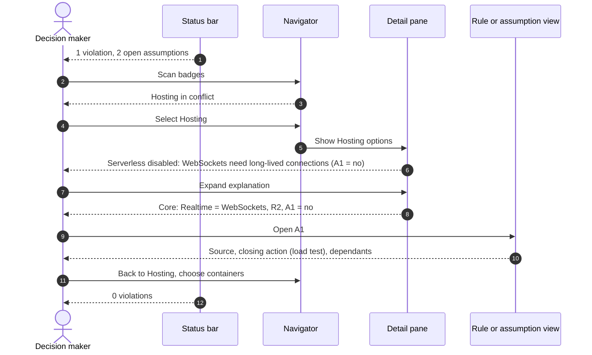

**Prototype:** a hierarchical HTML form, validated like a form.

- Decisions are fieldsets; `alternative` groups or enums become radio buttons; `or` groups become checkboxes; numeric values become inputs.
- After each change, the solver runs and infeasible options are disabled, each with its reason attached (`aria-describedby`).
- Violations go through the browser's own form validation (`setCustomValidity` with the rule's reason), so the native "invalid" UI shows the explanation.
- Rule nodes and assumptions are never rendered as choices. Export writes the configuration plus explanation trace as JSON.

The canvas, icons beyond the kind set, and the rule or assumption view can follow once the prototype proves the model.

## 7. LLM write-up

- **Input:** schema, configuration and explanation trace.
- **Output:** a decision record or spec section in a configurable template, with decisions attributed and kept separate from exploration.
- **Packaging:** a skill or a small script.

## 8. Worked example: a web application

A small, generic model used throughout this document and by the spike. It reproduces the shapes a real specification has: alternative decisions, rules that link them, an open question that feasibility depends on, and a decision whose justification has gone stale. The rules are illustrative, not authoritative engineering advice.

**Decisions**

| Id | Decision | Options |
| --- | --- | --- |
| Sessions | Session state | Server-side store · Signed token |
| Revocation | Logout behaviour | Instant revocation (optional) |
| Hosting | Where the app runs | Serverless functions · Containers |
| Realtime | Live updates | WebSockets · Polling |
| CDN | Static assets | Hosting provider's CDN · Independent CDN |

**Rules**

| Id | Rule | Reason |
| --- | --- | --- |
| R1 | Instant revocation ⇒ server-side sessions | A signed token stays valid until it expires |
| R2 | Serverless ∧ WebSockets ⇒ A1 | Serverless functions have a maximum duration; WebSockets need long-lived connections |
| R3 | Serverless ∧ server-side sessions ⇒ external session store | Function instances share no memory |
| R4 | Containers ⇒ an orchestrator or managed container service | Someone has to run the containers |
| R5 | Any CDN works with any host | Removes the original justification for "CDN = provider's CDN, decided by Hosting" |

**Assumptions**

| Id | Open question | Closing action |
| --- | --- | --- |
| A1 | Does the platform keep WebSocket connections open for a whole user session? | Load test |
| A2 | Is an external session store available in the target region? | Check the provider's region list |

Couplings the model should surface without manual rereading:

- Sessions = token → instant revocation is infeasible (R1).
- Hosting = serverless with Realtime = WebSockets → feasible only if A1 = yes (R2). If the load test closes A1 as "no", the configuration is in conflict, resolved by polling or by containers.
- Hosting = serverless with Sessions = server-side → needs an external session store (R3), which depends on A2.
- CDN = provider's CDN was "decided by Hosting", but R5 removes that justification, so the decision is flagged as stale.

Solid edges are rules. Dotted edges are assumptions (open questions) or a removed justification.

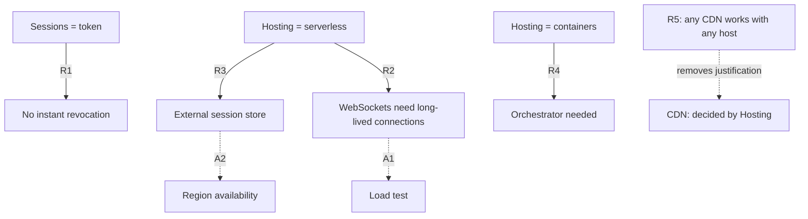

A real-world pilot of this approach on a production specification exists, but it is kept outside this repository.

## 9. Glossary

| Term | Meaning |
| --- | --- |
| **Constraint solver** | Software that finds assignments satisfying a set of constraints, or proves none exist |
| **CSP** | Constraint satisfaction problem: variables, domains, constraints |
| **SAT / SMT** | Boolean satisfiability / Satisfiability Modulo Theories (SAT plus arithmetic, strings and similar theories) |
| **Z3** | Microsoft's open-source SMT solver; the engine on the UVL route |
| **SMT-LIB** | Standard text format for SMT problems; Z3's native input |
| **MiniZinc / FlatZinc** | Solver-independent constraint modelling language / the low-level format it compiles to for solvers |
| **MUS** | Minimal unsatisfiable subset: a conflicting set of constraints where removing any one resolves the conflict |
| **FindMUS** | MiniZinc's tool for finding MUSes |
| **Provenance** | The record of what supports a value and who produced it; here, the evidence layer |
| **Soft constraint** | A constraint the solver may violate at a cost, used here for low-confidence rules |
| **Knowledge-based configuration** | Research field of interactive configurators backed by a domain knowledge base and a solver |
| **Configurator** | A UI that guides choices and keeps the configuration valid |
| **Feature model / variability model** | A tree of options with group types and cross-tree constraints |
| **Cross-tree constraint (CTC)** | A rule linking options in different branches, e.g. `A => !B` |
| **Language level (UVL)** | An opt-in subset of UVL syntax: Boolean, Arithmetic, Type |
| **Propagation** | Deriving which options remain feasible after a choice |
| **Unsatisfiable core** | A subset of constraints that is already contradictory, used as the explanation |
| **Minimal correction set** | The smallest set of choices to undo to restore feasibility |
| **QuickXplain** | An algorithm for computing minimal conflict explanations |
| **General morphological analysis** | Dimensions × values with a pairwise cross-consistency assessment |
| **CPQ** | Configure, Price, Quote: commercial product configurators |

## 10. Open questions

| # | Question | Action |
| --- | --- | --- |
| Q1 | Do UVL tools agree on the semantics of feature-attached `constraint` attributes (option A)? | Test in flamapy and `uvl-parser` |
| Q2 | Which UVL levels does the JS parser fully support? | Read the parser docs and test |
| Q3 | Can the browser solver (MiniZinc WebAssembly or Z3 WebAssembly) run from a plain static page, and inside a sandboxed host such as a published claude.ai artifact? | Spike |
| Q4 | Where does a model live: next to the specification it describes, or in a repository of its own? Models are loaded from outside this repository either way | Decide |
| Q5 | Are solver explanations readable by non-engineers without LLM rephrasing? | Pilot |
| Q6 | UVL with rule-as-feature or MiniZinc as the authoring language? | Spike both on the worked example (§8) |
| Q7 | Explanations from our own QuickXplain loop in the browser, or from FindMUS / flamapy through MCP? | Spike the loop first; it has no dependencies |
| Q8 | Which confidence bands and which hard/soft threshold? | Decide during the pilot |
| Q9 | Does the `mcp` capability reach a local `flamapy-mcp` (`host:<name>`) from a published page? | One test in the Claude app |
